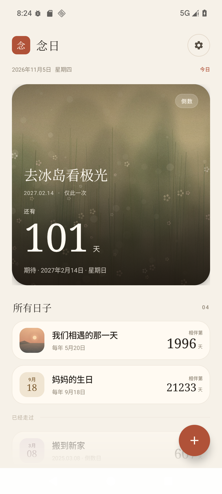
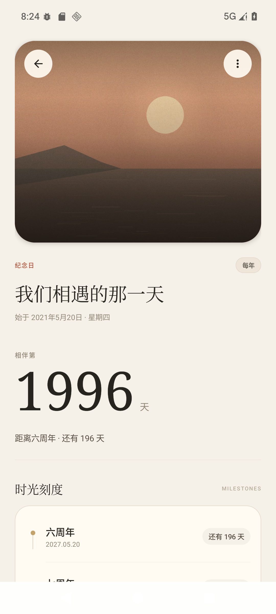
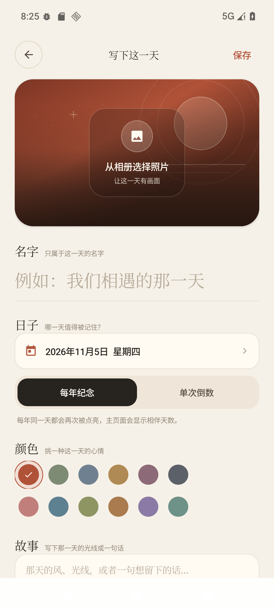
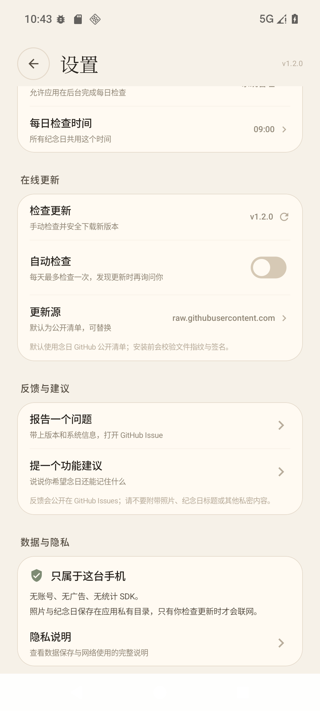
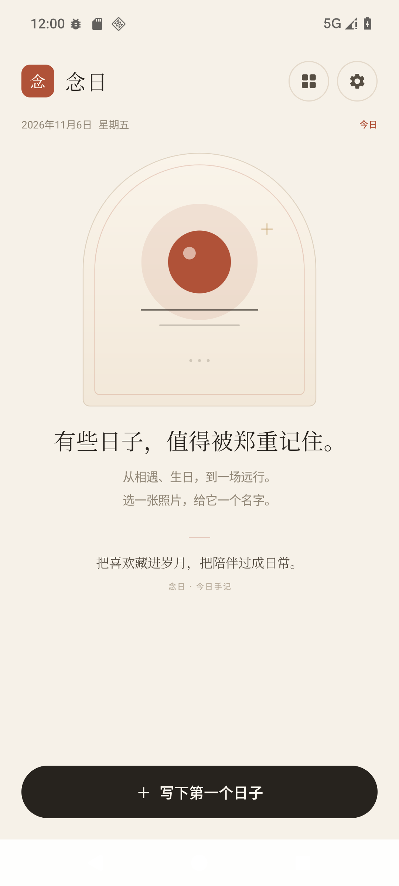

# 念日 · NianRi

一款干净、安静、完全本地优先的 Android 纪念日手帐。

没有广告，没有账号，没有统计 SDK。照片和纪念日默认只保存在这台手机里；只有你主动检查更新（或开启自动检查）时才会访问网络。

**安装包**：[`release/NianRi-Android-1.2.0.apk`](release/NianRi-Android-1.2.0.apk)  
**SHA-256**：[`release/SHA256-1.2.0.txt`](release/SHA256-1.2.0.txt)  
**安装说明**：[`release/安装说明.txt`](release/安装说明.txt)  
**GitHub**：[`ac1314-520/nianri`](https://github.com/ac1314-520/nianri)



| 详情 | 编辑 | 设置 | 空状态 |
| --- | --- | --- | --- |
|  |  |  |  |

> 预览图使用演示数据；实际安装后从空手帐开始。截图中的通知权限状态属于测试设备。

## 功能

| 功能 | 说明 |
| --- | --- |
| 纪念日 | 每年同一天重复，显示相伴天数与下一个周年倒计时 |
| 倒数日 | 一次性日期，可倒数未来，也可记录已经走过的日子 |
| 照片 | 直接打开系统照片选择器 / 相册（不再进入文件管理器的图片文件夹），自动压缩、修正 EXIF 方向并保存到应用私有目录 |
| 颜色 | 12 种低饱和色板，两行排布；没有照片时也会生成对应色调的落日画面 |
| 左滑删除 | 首页卡片和主卡都可以左滑删除，删除后 5 秒内可撤销；照片会等撤销窗口结束才真正清理 |
| 仪式感 | 大幅照片卡、纸张暖色、宋体数字、今日花瓣动画、周年刻度、每日手记 |
| 提醒 | 每个日子可开关提醒、提前 0–30 天；所有提醒共用一个每日检查时间 |
| 小米 / HyperOS | 精确闹钟状态、通知权限、电池优化、自启动入口与说明；开机后恢复提醒 |
| 在线更新 | 默认指向本仓库的公开清单；也可以换成自己的 HTTPS 地址；下载时校验 SHA-256、包名、版本号与签名后才允许安装 |
| 反馈与建议 | 「设置 → 反馈与建议」直接打开 GitHub Issues，自动带入版本、Android 版本和机型，分别按 bug / enhancement 标记 |
| 隐私 | 无广告、无登录、无埋点；不集成任何第三方统计或广告 SDK |

### 适用系统

- 最低 Android 8.0（API 26），目标 Android 16（API 36）
- 已在本机 Android 16 / API 36 模拟器上完成构建与运行验证
- 对小米 HyperOS / MIUI 做了提醒保活路径和兼容处理，但不同机型、不同系统版本的入口名称可能不同

## 安装

1. 把 `release/NianRi-Android-1.2.0.apk` 传到手机。
2. 点开安装；系统询问时允许「安装未知应用」。这是侧载应用的正常提示。
3. 第一次保存带提醒的纪念日时，系统会询问通知权限，请选择允许。
4. 打开「设置 → 提醒」，检查通知、精确提醒和电池优化状态。
5. 如果是小米 / Redmi / POCO：允许「自启动」，并把省电策略设为「无限制」。

APK 只使用以下权限：

- `INTERNET`：仅用于你主动发起的更新检查与下载
- `POST_NOTIFICATIONS`：发送纪念日提醒
- `SCHEDULE_EXACT_ALARM`：让每日检查尽量准时（未授权时自动降级为不精确闹钟）
- `RECEIVE_BOOT_COMPLETED`：重启后恢复提醒
- `REQUEST_INSTALL_PACKAGES`：安装你确认下载的更新
- `VIBRATE`：通知震动

## 使用

- 首页右下角的朱砂圆形按钮：新建纪念日。
- 选择照片时会直接打开 Android 系统照片选择器（或系统相册），只授予所选照片的临时读取权限。
- 在任意纪念日卡片或顶部主卡上向左滑动：删除；底部会出现「撤销」，5 秒内可恢复。
- 每年纪念：主数字是相伴天数，副文案提示距离下一个周年还有多少天。
- 单次倒数：未来显示「还有 N 天」，当天显示「今天」，过去显示「已经 N 天」。
- 详情页：查看周年刻度、故事和提醒；点「编辑这个日子」修改。详情页右上角菜单也可以删除。
- 提醒时间在「设置 → 提醒 → 每日检查时间」统一修改，修改后立即重新排程。
- 「设置 → 反馈与建议」可以报告问题或提功能建议；会打开 GitHub Issue，并自动带入版本、Android 版本和机型。
- 在线更新默认指向公开仓库的 `release/update.json`；只有手动检查或开启自动检查时才会访问。
- 如果错过提醒：请检查通知权限、精确提醒、电池优化和自启动；在 HyperOS 上建议把念日加入后台白名单。

## 在线更新

应用默认使用本仓库的公开更新清单，但安装后不会自动联网；只有手动检查更新，或主动开启自动检查后，才会访问该地址。你也可以在「设置 → 在线更新 → 更新源」换成自己的 HTTPS 清单，或清空关闭。

### 默认更新清单

念日 1.2.0 已内置下面地址：

```text
https://raw.githubusercontent.com/ac1314-520/nianri/main/release/update.json
```

如果手机当前是 1.0.0 或 1.1.0，会检测到 1.2.0；已经是 1.2.0 会提示已是最新。想换成自己的清单，进入「设置 → 在线更新 → 更新源」替换即可。

### 1. 清单格式

参见 [`release/update.example.json`](release/update.example.json)：

```json
{
  "versionCode": 4,
  "versionName": "1.2.1",
  "apkUrl": "https://example.com/nianri/NianRi-Android-1.2.1.apk",
  "sha256": "替换为新 APK 的 SHA-256",
  "notes": "• 修复了一些小问题\n• 优化了使用体验",
  "publishedAt": "2026-11-06"
}
```

- `versionCode` 必须大于当前安装包的版本号，也必须与 APK 内部的版本号一致。
- `apkUrl` 支持完整 HTTPS 地址，也支持相对清单地址的路径。
- `sha256` 必填，必须是 64 位十六进制字符串；应用下载时会实时计算并比对。
- 除哈希外，应用还会校验 APK 包名、版本号和签名证书。任何一项不一致都会拒绝安装。

### 2. 生成清单

仓库带了生成工具（需要 Python 3）：

```bash
python tools/make_update_manifest.py \
  --apk release/NianRi-Android-1.2.1.apk \
  --version-code 4 \
  --version-name 1.2.1 \
  --apk-url https://example.com/nianri/NianRi-Android-1.2.1.apk \
  --notes "· 一些小改进" \
  --out release/update.json
```

### 3. 发布

1. 将新 APK 上传到任意 HTTPS 静态空间（例如自己的服务器、对象存储、GitHub Release）。
2. 把生成的 `update.json` 上传到 HTTPS 地址。
3. 在应用里填写该 JSON 的地址，点「检查更新」。
4. 下载完成后，应用会先校验，再打开系统安装器；首次安装更新需要允许「安装未知应用」。

只有使用 `keystore/nianri-release.jks` 签名的后续版本才能覆盖安装。**请务必备份这个密钥和 `keystore/keystore.properties`；密钥丢失后无法生成可覆盖安装的更新。**

### 自动检查

- 默认关闭。
- 开启后，每次启动最多检查一次（24 小时内不会重复请求），发现新版本仍会先询问，不会自动下载或安装。
- 无更新或网络失败时不会弹出打扰；手动检查会显示失败原因。

## 小米 / HyperOS 提醒说明

系统级限制因 HyperOS 版本和机型而异，建议按这个顺序检查：

1. **通知权限**：设置 → 应用设置 → 应用管理 → 念日 → 通知管理，允许通知。
2. **精确提醒**：Android 12+ 的「闹钟与提醒」特殊权限。应用内「设置 → 精确提醒」会尝试打开对应页面；如果系统没有该页面，会退回应用详情。
3. **自启动**：设置 → 应用设置 → 应用管理 → 念日 → 自启动，允许。
4. **省电策略**：应用详情 → 省电策略 → 无限制。
5. **后台清理**：在最近任务中给念日加锁，避免一键清理杀掉应用。
6. 如果手机重启后提醒没有恢复，打开一次念日即可重新排程。

应用已包含：

- `BOOT_COMPLETED` / `MY_PACKAGE_REPLACED` 后恢复每日检查
- 精确闹钟不可用时的自动降级
- 每日通知去重
- 小米自启动设置入口的兼容尝试
- 应用内 HyperOS 提醒保障卡片

本项目没有在真实小米手机上做真机回归，因此不同系统的具体入口和后台限制仍需以你的手机为准。

## 从源码构建

要求：JDK 17、Android SDK Platform 36、Build-Tools 36.0.0。

```bash
cd nianri

# 任选一种方式让 Gradle 找到 SDK
export ANDROID_HOME=/path/to/android-sdk
# 或者创建 local.properties：
# sdk.dir=/path/to/android-sdk

./gradlew :app:assembleRelease
```

Windows 下可使用：

```powershell
$env:JAVA_HOME = "C:\path\to\jdk17"
$env:ANDROID_HOME = "C:\path\to\android-sdk"
.\gradlew.bat :app:assembleRelease
```

产物：`app/build/outputs/apk/release/app-release.apk`。

本项目的 `gradle.properties` 中设置了：

```properties
kotlin.compiler.execution.strategy=in-process
kotlin.incremental=false
```

这是为了兼容本机包含中文字符的工作区路径；在普通英文路径下也可以保留。

版本号在 `version.properties`，签名配置在 `keystore/keystore.properties`。发布新版本时：

1. 同时递增 `VERSION_CODE` 和 `VERSION_NAME`；
2. 使用同一把 release 密钥构建；
3. 用 `tools/make_update_manifest.py` 生成带有新 SHA-256 的 `update.json`；
4. 上传新 APK 和清单。

> 公开仓库不包含发布签名密钥，`keystore/` 只保留在维护者本地。仓库中的 `release/NianRi-Android-1.2.0.apk` 是已签名安装包；如果你从源码自行构建，需要使用自己的签名配置，不能覆盖官方签名的安装。

## 数据与备份

- 纪念日索引：`files/anniversaries.json`（应用私有目录）
- 照片：`files/photos/`
- `allowBackup=true`：由 Android 系统备份管理。是否上传到云备份取决于你的手机系统设置。
- 卸载应用会删除全部本地数据；升级安装不会。

## 项目结构

```
nianri/
  app/src/main/java/com/nianri/app/
    MainActivity.kt          页面切换、权限、安装更新、整体交互
    data/                    本地存储、偏好、图片导入与清理
    model/                   数据模型、日期展示与文案
    reminder/                闹钟排程、通知、开机恢复
    ui/                      首页、详情、编辑、设置、弹层、自绘组件
    update/                  清单解析、下载、哈希与签名校验
  app/src/main/res/          主题、图标、启动页与 XML 配置
  keystore/                  维护者本地签名（公开仓库不包含）
  release/                   已签名 APK、安装说明、更新清单模板
  tools/                     生成更新清单的小工具
  docs/                      预览图
```

## 已完成的验证

- Debug / Release 构建通过
- Android Lint 通过（仅保留本地化、KTX 建议等非阻断警告）
- Android 16 / API 36 模拟器安装与启动
- 系统照片选择器 → 压缩 → 保存 → 首页/详情显示
- 12 色板选择与无照片落日画面
- 首页主卡 / 列表卡片左滑删除；撤销恢复与照片延迟清理
- 反馈入口打开 GitHub Issue，预填版本、Android 版本与机型
- 默认更新源检查（公开 GitHub 清单）与自定义更新源
- 本地数据持久化、编辑、删除、返回确认
- 通知权限请求、每日闹钟到点发送通知
- Release APK 签名校验（APK Signature Scheme v2 / v3）
- Release 包实际安装与启动

## 设计说明

- 纸张色 `#F6F1E8`、朱砂 `#B05238`、墨色 `#27231E`
- 首页收紧了标题层级：去掉副品牌行、卡片上的重复英文标签，改用独立卡片 + 悬浮新建按钮
- 大标题、大数字使用系统衬线字体；没有额外字体包，减少体积
- 今日纪念日会落下少量花瓣；只播放一次，不打扰日常使用
- 没有插屏、开屏广告、Banner、推荐位或“猜你喜欢”
- 空状态、详情页、设置页都使用同一套排版语言
- 卡片大数字与左滑手势的设计参考了开源项目 [TickCount](https://github.com/ZZPBY/tickcount) 和 [Countdown-App](https://github.com/LaoYinBai/Countdown-App)；念日的界面和滑动组件为自绘实现

## 版本记录

### 1.2.0（2026-11-06）

- 设置新增「反馈与建议」：报告问题、提功能建议分别打开对应的 GitHub Issue
- Issue 自动带入应用版本、Android 版本、机型，并提示不要附带私密内容
- 在线更新默认指向公开仓库的 `release/update.json`，不再为空
- 更新源自定义和隐私说明同步调整；自动检查仍默认关闭
- 新增发布包 `NianRi-Android-1.2.0.apk`

### 1.1.0（2026-11-05）

- 相册选择改为系统照片选择器：点照片直接进入相册 / Photos / Albums，不再打开文件管理器
- 颜色从 6 种扩展到 12 种，改为两行色板并增加选中勾
- 首页重新排版：更轻的日期头、更干净的主卡、独立卡片列表、悬浮新建按钮
- 增加左滑删除和 5 秒撤销；删除时晚清理照片，撤销可以完整恢复
- 详情页减少重复标签、压缩封面高度，修正“已走过”页面的提示文案
- 在线更新说明与发布版本号同步升级

### 1.0.0（2026-11-05）

- 首个本地优先版本：纪念日 / 倒数日、照片、提醒、HyperOS 指引、在线更新

## 第三方组件

- AndroidX Core（Apache License 2.0）
- Android 系统组件：AlarmManager、Notification、Activity、View、java.time 等

除此之外没有网络框架、广告 SDK、统计 SDK 或账号 SDK。
